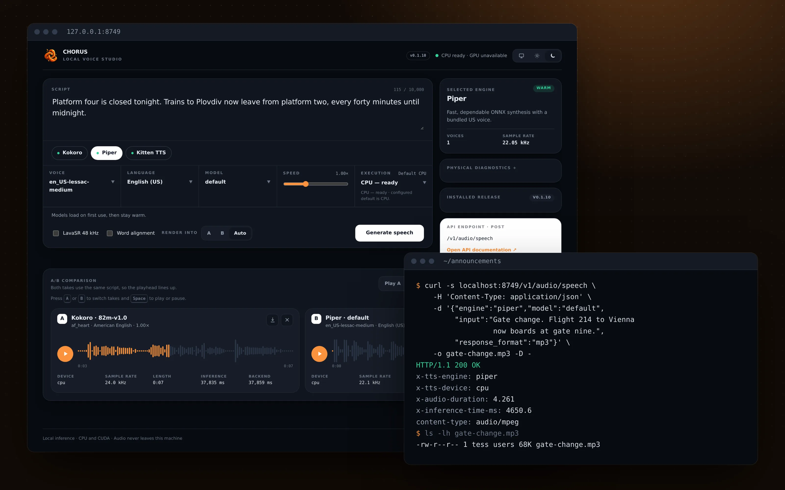
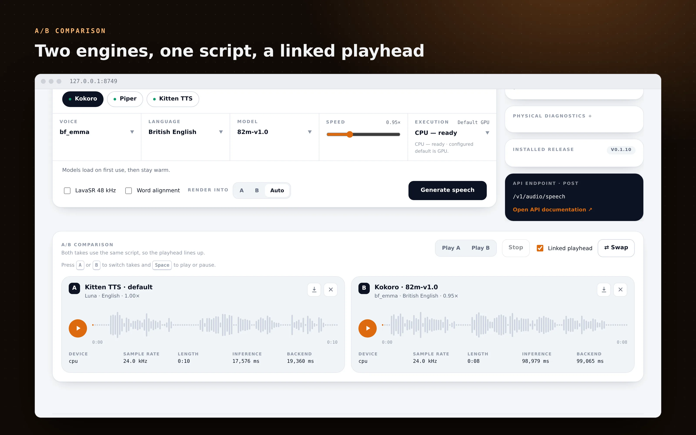
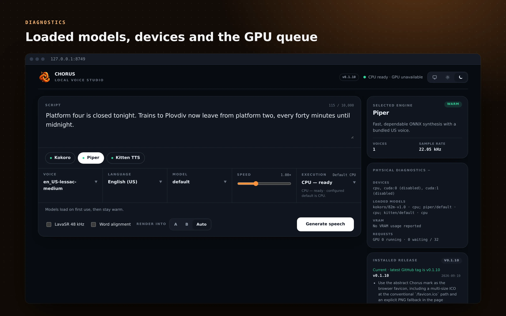
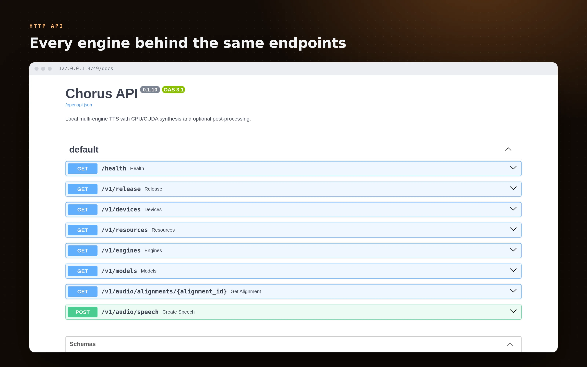

<p align="center">
  
</p>

<p align="center">
  <a href="https://github.com/Fractal-Tess/chorus/tags"></a>
  <a href="docs/docker.md"></a>
  <a href="docs/api.md"></a>
</p>

<h1 align="center">Chorus</h1>

<p align="center">
  
</p>

<p align="center">
  Local text-to-speech engines behind one CPU/CUDA API and a browser console.
</p>

Chorus runs open text-to-speech models on your own machine and puts them behind one HTTP endpoint, so an application can switch engines by changing a field instead of a client library. The browser console renders the same script with two engines side by side, so choosing a voice comes down to listening to both. Nothing is sent to a hosted speech API.

- **Serve** seven engines: Pocket TTS, Kokoro, Piper, Kitten TTS, Supertonic 3, Breeze TTS 2 and Fish Audio S2-Pro.
- **Schedule** work on logical CPU and GPU channels with a shared GPU queue, idle unloading and optional memory budgets.
- **Return** WAV, MP3, FLAC or Opus, with optional 48 kHz enhancement and English word timestamps.

## Quick start

Install Python 3.12, `uv`, Git, FFmpeg, SoX, eSpeak NG and libsndfile, then clone without the model binaries and start Kokoro on the CPU:

```sh
GIT_LFS_SKIP_SMUDGE=1 git clone https://github.com/Fractal-Tess/chorus.git
cd chorus
uv sync --locked --python 3.12
uv run serve-api --engines kokoro --download-missing --devices cpu
```

`--download-missing` fetches the pinned weights from upstream and checks their SHA-256 hashes. Open [localhost:8749](http://127.0.0.1:8749) for the console, or request speech directly:

```sh
curl --fail-with-body http://127.0.0.1:8749/v1/audio/speech \
  -H 'Content-Type: application/json' \
  -d '{"engine":"kokoro","model":"82m-v1.0","channel":"cpu","input":"A quiet test from the CPU.","response_format":"wav"}' \
  --output kokoro-cpu.wav
```

Kokoro defaults to the GPU channel, so the request asks for `cpu` explicitly. An explicit GPU request never falls back to the CPU. Interactive API documentation is at [localhost:8749/docs](http://127.0.0.1:8749/docs).

With Docker, `docker compose up --build` starts the same Kokoro CPU setup with persistent model and cache volumes. With Nix, `nix develop path:./nix` gives you the launcher and audio tools, and `nixosModules.default` runs Chorus as a service. See the [Docker guide](docs/docker.md) and [setup guide](docs/setup.md) for CUDA, CDI, NixOS options and model storage.

The API has no authentication. Keep it on localhost or a trusted private network.

## Supported models

| Engine | Model ID | CPU | GPU (CUDA) |
| --- | --- | :---: | :---: |
| Pocket TTS | `default` | ✅ | ❌ |
| Kokoro | `82m-v1.0` | ✅ | ✅ |
| Piper | `default` (`en_US-lessac-medium`) | ✅ | ❌ |
| Kitten TTS | `default` (`kitten-tts-nano-0.8`) | ✅ | ❌ |
| Supertonic 3 | `default` (`supertonic-3`) | ✅ | ❌ |
| Breeze TTS 2 | `tts-2` | ❌ | ✅ |
| Fish Audio S2-Pro | `s2-pro` | ❌ | ✅ |

Breeze and Fish run in separate runtimes, are not in the Docker image, and have research or non-commercial model licenses. Read their [license notes](docs/setup.md#breeze-setup) before use.

## A closer look

<table>
  <tr>
    <td></td>
    <td></td>
  </tr>
  <tr>
    <td colspan="2"></td>
  </tr>
</table>

## Documentation

- [Tutorials](docs/tutorials.md): source-only cloning, the Nix shell, selective model downloads, CPU and GPU requests.
- [Setup](docs/setup.md): model downloads, NVIDIA support, the NixOS service, Breeze and Fish.
- [Docker](docs/docker.md): image build, CPU, CUDA and CDI runs, persistent storage.
- [API and runtime](docs/api.md): engines, voices, channels, the GPU queue, memory budgets and endpoints.
- [Development](docs/development.md): code layout, tests, releases, README images and measured Kokoro performance.
- [Changelog](CHANGELOG.md): release history.
